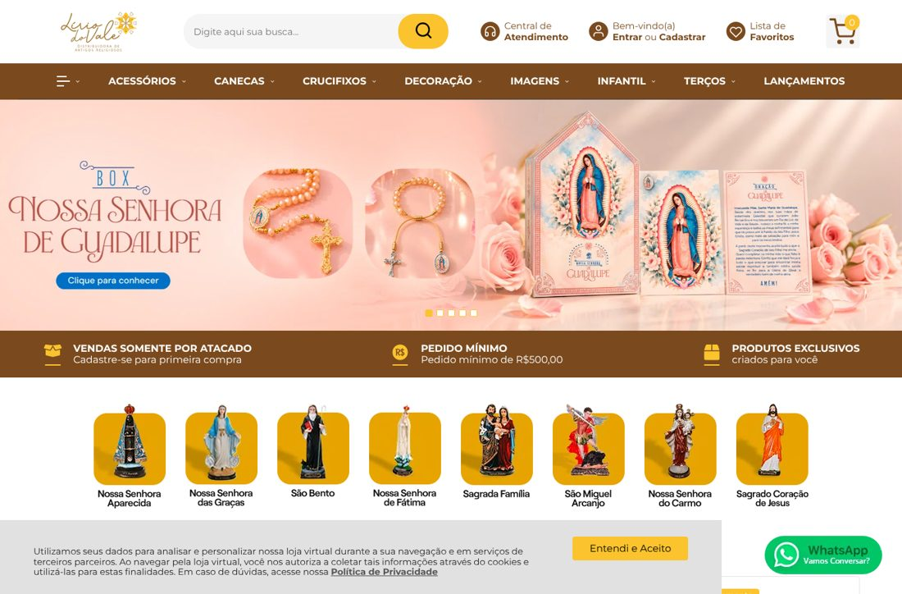
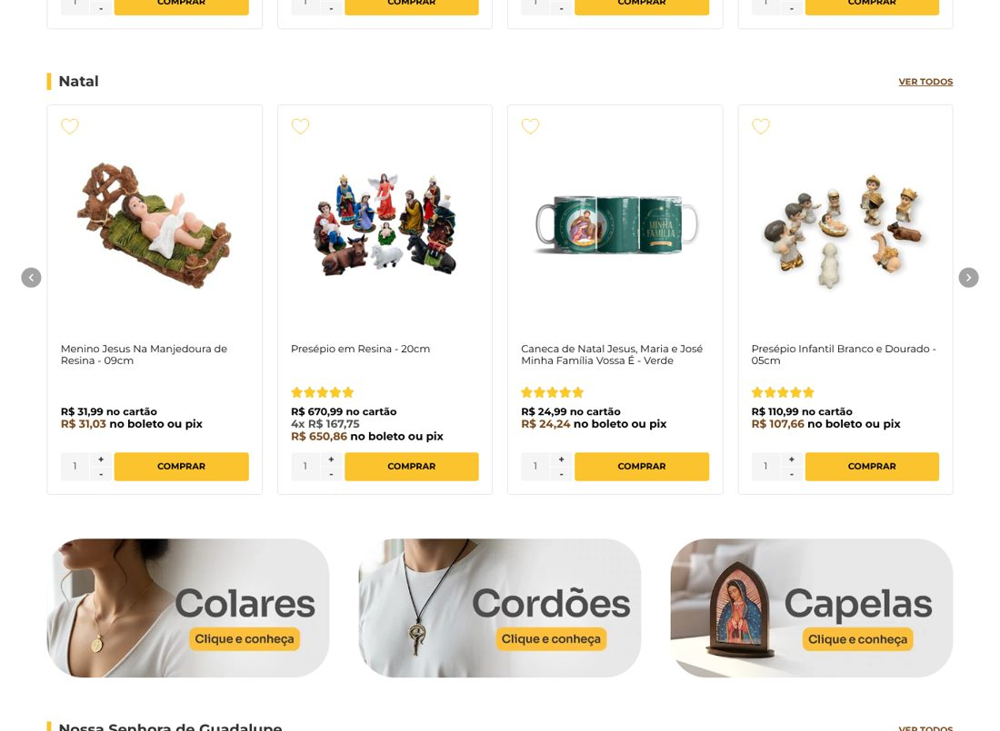
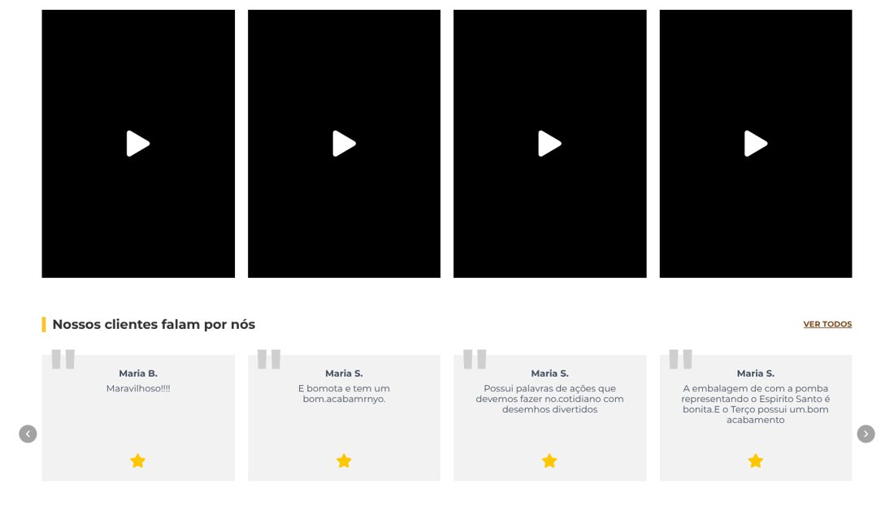
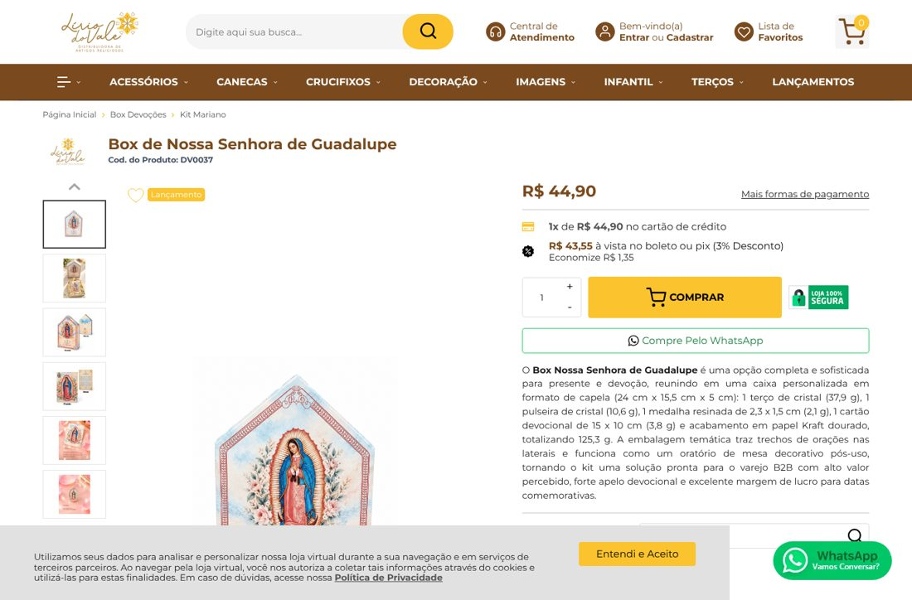

# 1. Resumo executivo

**Nota geral do site: 7 de 10.** É uma loja **bonita, organizada e com cara de atacado sério**: preço visível, pedido mínimo claro, botão de WhatsApp e descrições de produto ricas nos lançamentos. O que segura a nota são **detalhes que custam vendas e posição no Google**: um cadastro longo e sem as perguntas certas, páginas institucionais desatualizadas, depoimentos fracos (com erro de digitação e uma estrela só), SEO incompleto e duas ferramentas de medição duplicadas.

| Área | Nota | Em uma frase |
|---|---|---|
| Identidade visual | 8 | Coerente (marrom + dourado + Montserrat); o banner atual foge da paleta |
| Clareza da proposta de atacado | 8 | "Somente atacado / pedido mínimo R$ 500" está no topo, no computador e no celular |
| Página de produto | 8 | Preço, Pix com desconto, "Compre pelo WhatsApp", descrição rica e dados para o Google |
| Cadastro e "Como comprar" | 4 | Formulário longo, pede RG e sexo, não pergunta tipo de cliente nem como conheceu |
| Prova social (depoimentos) | 3 | Nomes repetidos, erros de digitação, aparece só 1 estrela |
| SEO técnico | 6 | Produtos bem marcados; home sem título principal; 27% das páginas sem descrição |
| Medição | 5 | Dois Google Analytics; Pixel do Meta não confirmado |

> 📌 **Como foi feita esta análise:** abri o site como um visitante, no computador e no celular, tirei prints, extraí cores e fontes direto do código e analisei automaticamente **285 páginas** (143 produtos, categorias, institucionais e avaliações). O site passou a bloquear visitas automáticas rápidas (erro 429, "Verificação de segurança") depois de umas 285 páginas, então parei para não sobrecarregar. A amostra é suficiente para as conclusões abaixo. **Não tive acesso** ao painel da loja, ao Google Analytics nem ao Search Console, então aqui não há números de visitas e vendas.

# 2. Identidade visual

## Paleta de cores (extraída do código do site e do logotipo)

| Cor | Código | Onde aparece | Papel |
|---|---|---|---|
|  Marrom café | `#7A4A1E` | Menu, faixa de benefícios, títulos de produto | **Cor principal** (seriedade, madeira, tradição) |
|  Amarelo-ouro | `#FBC32D` | Botões "Comprar", busca, fundos dos santos | **Cor de ação** (chama o clique) |
|  Bronze do logo | `#A07030` | Letra "Lírio do Vale" do logo | Cor da marca |
|  Dourado do logo | `#F0C020` | Flor/estrela do logo | Cor da marca |
|  Grafite | `#333333` / `#000` | Textos | Leitura |
|  Cinza claro | `#F5F5F5` | Fundos de seção | Respiro |

- **Fonte do site:** **Montserrat** em 100% dos textos. É moderna, limpa e muito legível no celular. ✅
- **Logotipo:** "Lírio do Vale" em letra cursiva (manuscrita) bronze, com uma flor/estrela dourada e o subtítulo "Distribuidora de Artigos Religiosos". Transmite delicadeza e tradição. ✅
- **Estilo das fotos:** produto em fundo branco nas vitrines (bom para o lojista enxergar a peça). Os banners usam **fotos ambientadas** (rosas, tons pastel).

## O que está bom
- Marrom + dourado tem **tudo a ver com artigo religioso** (madeira, ouro, igreja) e diferencia a Lírio dos concorrentes, que costumam usar azul ou branco.
- Os **atalhos por devoção** (Aparecida, Graças, São Bento, Fátima, Sagrada Família, São Miguel, Carmo, Sagrado Coração), com a imagem do santo em fundo dourado, são o melhor elemento visual do site. É assim que o lojista pensa: "o que meu cliente pede".
- A faixa **"Vendas somente por atacado · Pedido mínimo R$ 500 · Produtos exclusivos"** logo abaixo do banner é perfeita. Ela filtra o consumidor final e tranquiliza o lojista.

## O que pode melhorar
- 🟡 **O banner atual (Box Guadalupe) foge da identidade.** Ele tem tons rosa pastel e um **botão azul** ("Clique para conhecer"), que não aparece em nenhum outro lugar do site. O azul "grita" diferente do marrom e dourado. **Sugestão:** botões dos banners sempre em amarelo-ouro ou marrom.
- 🟡 **O banner fala com o consumidor final, não com o lojista.** "Box Nossa Senhora de Guadalupe / Clique para conhecer" é linguagem de varejo. Para o atacado, o banner deveria dizer o **benefício para a loja**: "Lançamento exclusivo · alto giro no Natal · a partir de X unidades".
- 🟡 **No celular**, o aviso de cookies cobre **quase metade da tela** na primeira visita, e os "pontinhos" do carrossel ficam **em cima do botão** "Clique para conhecer" (veja o print).

> 📌 **Anotação — manual da marca:** não encontrei um padrão escrito (manual de marca). Recomendo criar um de 1 página: cores com código, fonte, uso do logo, estilo de foto e tom de voz. Isso vira a base do "segundo cérebro" e garante que a Priscila, a equipe e o agente de IA produzam peças coerentes.

# 3. Experiência de compra (do ponto de vista do lojista)

## Página inicial
Ordem das seções: banner → faixa de atacado → atalhos por devoção → **Novidades** → **Natal** → banners de categoria (Colares, Cordões, Capelas) → **Nossa Senhora de Guadalupe** → **Infantil** → **Nossa Senhora das Graças** → Vídeos → Depoimentos → rodapé.

- ✅ Vitrines por tema e data (Natal, Guadalupe em 12/dez) mostram que **alguém está cuidando da vitrine conforme o calendário**. Isso é ótimo.
- ✅ Preço no cartão **e** no Pix/boleto (3% de desconto) direto na vitrine, com botão "Comprar" e seletor de quantidade.
- 🟡 **Falta uma entrada para quem chega pela primeira vez.** Não há no topo um "Seja revendedor / Como comprar no atacado" nem um "Para paróquias". O lojista novo não sabe se precisa de CNPJ, como é o frete ou o prazo.
- 🟡 **"Sacramentos" (Primeira Comunhão, Crisma, Batizado, Casamento) está escondido** no menu "hambúrguer" (☰). Para as **paróquias**, essa é uma das categorias mais importantes. Deveria estar no menu principal, pelo menos na época de planejamento (janeiro a março).

## Depoimentos: o ponto mais fraco da página inicial

- 🔴 Aparecem **"Maria B." e três vezes "Maria S."**, com textos curtos e **erros de digitação** ("E bomota e tem um bom.acabamrnyo").
- 🔴 Cada depoimento mostra **uma estrela só**. Quem bate o olho pode entender **nota 1 de 5**.
- 🔴 São depoimentos de **consumidor** ("bonita", "desenhos divertidos"), não de **lojista**. Para o atacado, a prova social que convence é: *"Revendo Lírio do Vale há 3 anos na minha loja em Aparecida-SP. Gira rápido e o atendimento é excelente." — Ana, Loja Fé & Luz*.
- 💡 A área de avaliações tem material melhor, como "**Lindo! Pedi pra teste e já vendi ❤️**". Esse é o tipo de frase que vende para o lojista e deveria estar na página inicial.

> 📌 **Anotação — Google:** num anúncio do Google aparece a ficha da empresa com **nota 4,7 ★ (44 avaliações)**. Essa nota deveria estar visível no site ("4,7 no Google, 44 avaliações").

## Página de produto

- ✅ Título claro, código do produto, preço, **Pix com 3% de desconto**, botão **"Compre pelo WhatsApp"** (excelente para o atacado) e selo "Loja 100% segura".
- ✅ **As descrições dos lançamentos são muito boas.** O Box Guadalupe tem medidas, peso de cada item, o que vem na caixa e argumentos de venda ("funciona como oratório de mesa"). Isso ajuda o lojista a revender e ajuda o Google.
- 🟡 **Linguagem interna vazando:** a descrição fala em "solução pronta para o **varejo B2B**" e "**Gift-Ready**". O lojista copia a descrição para o Instagram ou o marketplace dele, e esses termos não fazem sentido para o cliente final. **Sugestão:** separar um bloco "**Para o lojista**" (margem, giro, exposição) de um bloco "**Descrição para seu cliente**", pronto para copiar.
- 🟡 **Falta o "preço sugerido de revenda"**, uma das informações que o lojista mais valoriza. "Você paga R$ 44,90, sugerimos vender por R$ 89,90" vende sozinho.
- 🟡 **Inconsistência com o anúncio do Meta:** o anúncio diz que o Box Guadalupe tem "Terço de Cristal, **Dezena de Pulso, Ícone de Mesa** e Card Devocional", e o site diz "terço, **pulseira**, **medalha** e cartão". Precisa padronizar, porque o lojista percebe.

## Cadastro e "Como comprar": onde o atacado perde clientes
- 🔴 **O formulário de cadastro tem cerca de 22 campos**, pede **RG, sexo e data de nascimento** (na pessoa física) e aceita CPF e CNPJ. Cada campo a mais é gente desistindo.
- 🔴 **Ele não pergunta o que mais importa para o marketing:**
  1. **Tipo de cliente:** loja, paróquia, revendedor autônomo, livraria…
  2. **Como conheceu a Lírio:** Google, Instagram, indicação, feira…

  Sem esses dois campos, **é impossível saber se o anúncio está trazendo cliente**, e o e-mail marketing não consegue separar lojista de paróquia.
- 🔴 **A página "Como comprar" é um texto genérico da plataforma.** Não fala de **atacado, pedido mínimo, CNPJ nem prazo**, e menciona **PagSeguro e depósito bancário**, que provavelmente nem estão mais em uso. É uma página que o lojista novo lê com atenção, e hoje ela não ajuda.
- 🟡 A página "Política de entrega" não informa **prazos médios por região** nem **a partir de quanto o frete fica mais barato**, duas dúvidas clássicas de quem compra no atacado.

# 4. SEO (aparecer no Google)

| Ponto verificado | Resultado | Situação |
|---|---|---|
| Página inicial com título principal (H1) | **Não tem** | 🔴 |
| Páginas de produto com H1, dados de produto (schema) e "migalha" (breadcrumb) | 143 de 143 | ✅ |
| Produtos com nota em estrelas para o Google | 35 de 143 (24%) | 🟡 |
| Páginas sem descrição para o Google | 76 de 285 (27%), incluindo Quem Somos, Como Comprar e várias categorias | 🔴 |
| Páginas usando a **mesma** descrição genérica da home | 44 | 🔴 |
| Imagens sem texto alternativo (alt) | 2.457 de 7.060 (35%) | 🟡 |
| Cada avaliação vira uma página própria, com título "Perfeito", "Lindo"… | Dezenas de páginas assim | 🟡 |
| Título da home | "Lirio do Vale Distribuidora de Artigos Religiosos - Vendas no Atacado", **sem acento em "Lírio"** | 🟡 |
| Mapa do site (sitemap) | Declarado, mas hospedado em domínio da plataforma (Climba) | ⚪ conferir no Search Console |

> 📌 **Anotação:** a descrição da home para o Google é boa ("Atacado de artigos religiosos católicos… para lojistas, revendedores, igrejas"), mas a lista de palavras-chave no código tem erros de digitação ("atacade artigodo", "distribuidoras s religiosos"). O Google ignora esse campo há anos, então não prejudica, mas mostra falta de revisão. Pode ser apagado.

**Palavras que o lojista pesquisa e que o site deveria disputar** (com uma página de categoria bem escrita para cada): *atacado de artigos religiosos*, *distribuidora de artigos religiosos*, *terço no atacado*, *imagens de santos atacado*, *artigos religiosos para revenda*, *lembrancinha de primeira comunhão atacado*, *artigos religiosos Cachoeira Paulista / Aparecida*.

# 5. Medição e ferramentas

- **Plataforma:** Climba / IDCommerce. Carregamento de **3,4 a 3,8 segundos** e cerca de 125 arquivos por página, o que é aceitável. O ideal é ficar abaixo de 3 s no celular.
- **Google Tag Manager** (GTM-P378H55Q) instalado. ✅
- 🔴 **Dois Google Analytics 4 diferentes** (G-Q17NWCFEC2 e G-JF5RCD21V4). Ou os números estão divididos, ou estão contados em dobro. Precisa definir **um oficial**.
- ✅ **Google Ads** (AW-647507859) instalado.
- 🟡 **Pixel do Meta** não aparece direto no código. Pode estar no Tag Manager. Os anúncios do Meta estão rodando agora (ver relatório de Meta Ads), então **confirmar o pixel é urgente**.
- ✅ **RD Station** instalado (formulários e e-mail).

# 6. O que performa bem e o que não performa (na leitura do site)

> ⚠️ Sem acesso ao Analytics, isto é **avaliação de especialista**, não dado de vendas. Quando tivermos o GA4, confirmamos ou corrigimos.

**Provavelmente performa bem**
- **Lançamentos com descrição rica** (Box Guadalupe, canecas aquarela). Têm conteúdo para o Google e para o lojista.
- **Atalhos por devoção** e vitrines por data.
- O botão **"Compre pelo WhatsApp"**, que leva para onde o atacado fecha venda.

**Provavelmente performa mal**
- **Cadastro**: muitos campos, sem explicar o porquê.
- **"Como comprar"** genérico e desatualizado.
- **Depoimentos** atuais, que podem até afastar.
- **Categorias sem texto**: o Google não entende do que se trata a página.

# 7. Ideias para vender mais pelo site

1. **Página "Seja revendedor Lírio do Vale"** no menu principal: como funciona, pedido mínimo, prazo, frete, formas de pagamento, depoimentos de lojistas e botão de WhatsApp. Ela vira a página de destino dos anúncios.
2. **Página "Para paróquias"**: kits de Primeira Comunhão e Crisma, lembrancinhas, itens para a loja da paróquia, com orçamento pelo WhatsApp.
3. **Cadastro em 2 etapas**: primeiro só CNPJ ou CPF, nome, WhatsApp, **tipo de cliente** e **como conheceu**; o restante só na hora do primeiro pedido.
4. **"Kits prontos para revenda"** com margem sugerida, por exemplo "Kit Natal para loja pequena: 60 peças, R$ 520". Isso resolve o pedido mínimo e facilita a primeira compra.
5. **Catálogo em PDF por data** (Natal, Quaresma, Primeira Comunhão) para baixar em troca do contato (lead).
6. **Depoimentos reais de lojistas**, com foto da loja e cidade, e a nota 4,7 do Google na página inicial.
7. **Preço sugerido de revenda** e bloco "texto pronto para seu Instagram" em cada produto.

# 8. Plano de ação

| Prioridade | Ação | Quem |
|---|---|---|
| 🔴 Agora | Confirmar o Pixel do Meta e escolher **um** GA4 oficial | TI |
| 🔴 Agora | Trocar os depoimentos da página inicial (reais, de lojistas, sem erro, 5 estrelas corretas) | Marketing |
| 🔴 Agora | Reescrever "Como comprar" com atacado, pedido mínimo, CNPJ, prazos e pagamentos atuais | Marketing |
| 🟠 Este mês | Adicionar ao cadastro "Tipo de cliente" e "Como conheceu"; retirar RG e sexo | TI + plataforma Climba |
| 🟠 Este mês | Página "Seja revendedor" e página "Para paróquias" | Marketing + TI |
| 🟠 Este mês | Padronizar a composição do Box Guadalupe entre site e anúncios | Marketing |
| 🟡 Próximo mês | H1 na home; descrições para Google em categorias e institucionais; alt nas imagens | TI/Marketing |
| 🟡 Próximo mês | Botões de banner sempre na paleta; aviso de cookies menor no celular | TI |
| 🟢 Contínuo | Preço sugerido de revenda e texto "para seu cliente" em cada produto novo | Marketing (o agente gera) |
