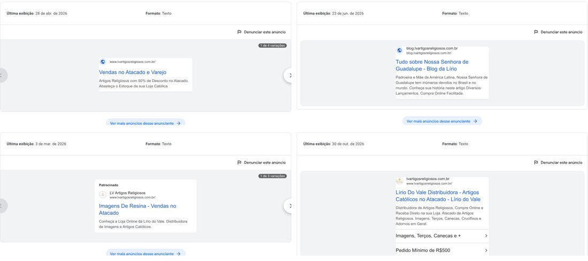
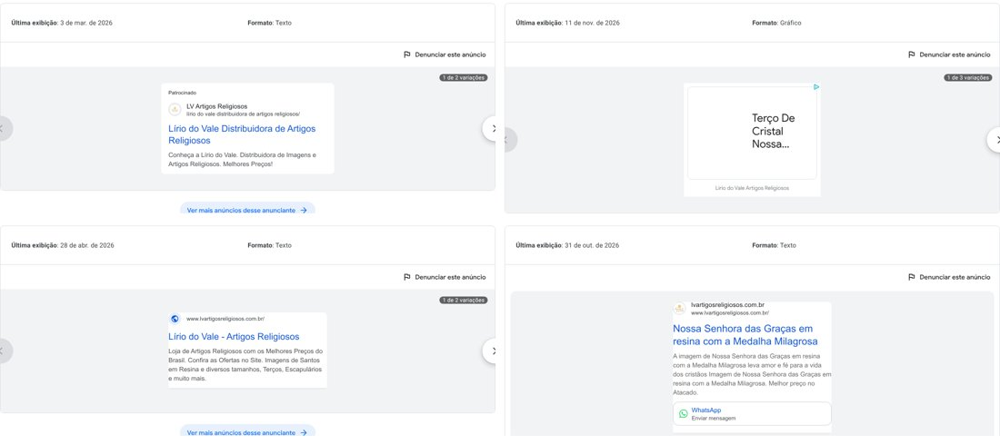
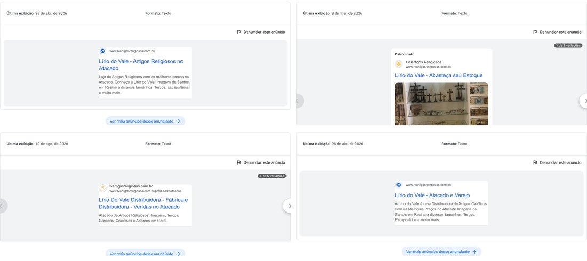
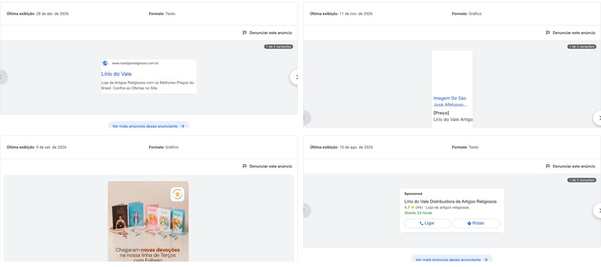
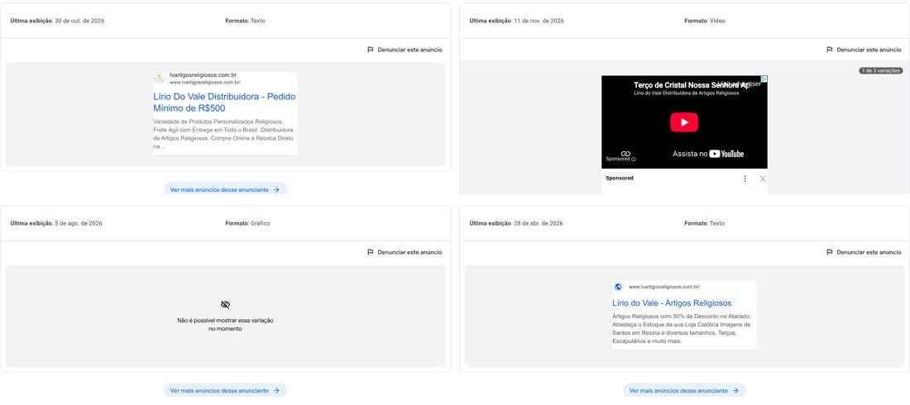
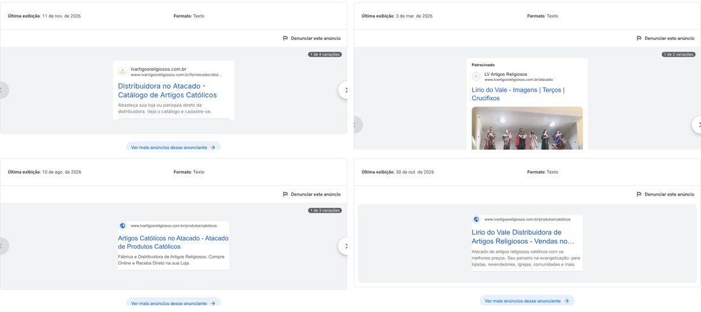
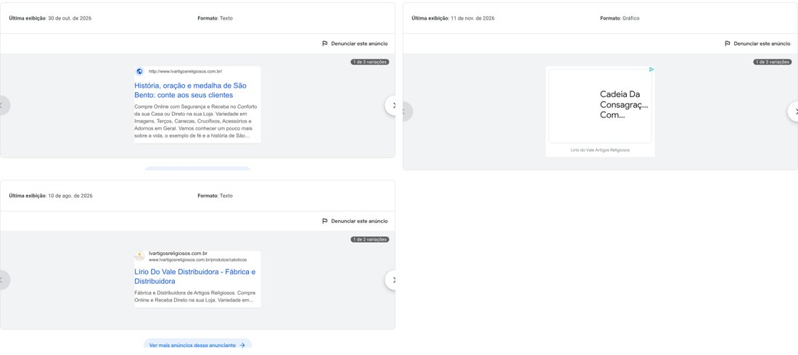

# 1. Antes de tudo: o que dá e o que não dá para ver

O Google tem uma página pública, a **Central de Transparência de Anúncios**, onde qualquer pessoa vê **quais anúncios** uma empresa veiculou, em **qual formato** e **quando foi a última exibição**. Foi daí que tirei esta análise.

| Consigo ver (público) | **Não** consigo ver (só com acesso à conta do Google Ads) |
|---|---|
| Texto e imagem dos anúncios | Quanto foi gasto |
| Formato (texto, gráfico/display, vídeo) | Cliques, custo por clique, conversões, vendas |
| Data da última exibição | Quais palavras-chave estão sendo compradas |
| Endereço exibido (página de destino) | Para quem e em que região os anúncios aparecem |
| Se o anunciante é verificado | Qual campanha dá lucro e qual dá prejuízo |

> 📌 **Para o seu chefe:** dá para avaliar **a qualidade e a estratégia** dos anúncios, mas **não o resultado em dinheiro**. Para responder "estamos ganhando ou perdendo dinheiro no Google?", preciso de **acesso de leitura** à conta do Google Ads (ou de um relatório exportado). O passo a passo está no final deste documento.

# 2. Resumo executivo

- A Lírio do Vale é **anunciante verificada** no Google, com **31 anúncios** registrados no Brasil em 2026 e veiculação em **quase todos os meses** (mar, abr, jun, ago, set, out e nov).
- **Estão no ar agora** (última exibição em 11/11/2026):
  - anúncios **gráficos de produto**, que aparecem em sites e apps: Terço de Cristal, Imagem de São José, Cadeia da Consagração;
  - um **vídeo no YouTube** (Terço de Cristal Nossa Senhora);
  - um anúncio de **pesquisa** com texto B2B muito bom: "Distribuidora no Atacado: Catálogo de Artigos Católicos".
- **O problema principal é a mensagem inconsistente ao longo do ano.** Vários anúncios falam em **"Atacado e Varejo"**, **"50% de desconto"**, **"Receba no conforto da sua casa"** e até levam para **posts do blog**. Esse é o texto de quem vende para o **consumidor final**, mas a Lírio **só vende no atacado**. Isso tende a gerar **cliques pagos de quem nunca vai comprar**.
- A ficha do Google (perfil da empresa) aparece num anúncio com **4,7 ★ (44 avaliações)**, mas também com **"Aberto 24 horas"**, o que muito provavelmente está **errado**.

**Nota da estratégia de Google Ads (pelo que é público): 5 de 10.** Os anúncios novos estão no caminho certo; os antigos mostram que, por meses, o dinheiro pode ter ido para o público errado.

# 3. Os anúncios, um por um (agrupados)

## 3.1 Anúncios de pesquisa (texto): aparecem quando alguém pesquisa no Google

| Última exibição | Título do anúncio | Avaliação |
|---|---|---|
| 11/11/2026 | **Distribuidora no Atacado · Catálogo de Artigos Católicos.** "Abasteça sua loja ou paróquia direto da distribuidora. Veja o catálogo e cadastre-se." (página `/fornecedor/distribuidora`) | ✅ **Excelente.** Fala com lojista **e** paróquia, tem chamada para cadastro e página própria |
| 31/10/2026 | **Nossa Senhora das Graças em resina com a Medalha Milagrosa.** "...Melhor preço no Atacado", com botão de WhatsApp | ✅ Bom: anúncio de produto com WhatsApp. Faltou dizer "para sua loja" |
| 30/10/2026 | **Lírio do Vale Distribuidora · Pedido Mínimo de R$500.** "Variedade de Produtos Personalizados Religiosos, Frete Ágil..." | ✅ Bom: o pedido mínimo no título filtra o consumidor final |
| 30/10/2026 | **Lírio do Vale Distribuidora · Artigos Católicos no Atacado**, com links extras "Imagens, Terços, Canecas e +" e "Pedido Mínimo de R$500" | ✅ Bom |
| 30/10/2026 | **"História, oração e medalha de São Bento: conte aos seus clientes"**, com o texto "Compre Online com Segurança e **Receba no Conforto da sua Casa**" e endereço `http://` (sem o "s") | 🔴 **Ruim.** Mistura título de post do blog (de 2020) com promessa de varejo. Atrai devoto curioso, não lojista |
| 10/08/2026 | **"Lírio do Vale Distribuidora · Fábrica e Distribuidora · Vendas no Atacado"** (5 variações) | 🟡 Ok. **Atenção:** a Lírio é **fábrica**? Se não for, é promessa enganosa |
| 10/08/2026 | **Anúncio de ligação/rota:** "Lírio do Vale Distribuidora de Artigos Religiosos · **4,7 ★ (44)** · Loja de artigos religiosos · **Aberto 24 horas**" | 🔴 **"Aberto 24 horas" muito provavelmente está errado** para uma distribuidora (o site informa entregas de segunda a sexta, das 8h às 17h). Isso leva gente a ligar ou ir até lá fora do horário. **Conferir e corrigir** |
| 23/06/2026 | **"Tudo sobre Nossa Senhora de Guadalupe · Blog da Lírio"**, levando para o blog | 🔴 **Pagar clique para levar ao blog** atrai o público devoto em geral, não o lojista. Só faz sentido se o post tiver captura de contato |
| 28/04/2026 | **"Vendas no Atacado e Varejo"** / **"Lírio do Vale · Atacado e Varejo"** | 🔴 **Contradiz o site** ("Vendas somente por atacado"). Paga clique de consumidor final |
| 28/04/2026 | **"Artigos Religiosos com 50% de Desconto no Atacado"** | 🔴 Promessa forte e genérica, e o Google pode reprovar por falta de comprovação. Quem clica esperando 50% e não encontra, sai |
| 03/03/2026 | **"LV Artigos Religiosos · Imagens de Resina · Vendas no Atacado"** e "Lírio do Vale · Abasteça seu Estoque" (com foto de loja) | 🟡 Ok, mas o nome aparece como **"LV Artigos Religiosos"**, diferente da marca "Lírio do Vale" |

## 3.2 Anúncios gráficos (display) e de vídeo (YouTube)

- **No ar em 11/11/2026:** anúncios de produto (Terço de Cristal Nossa Senhora, Imagem de São José Afetuoso 20 cm, Cadeia da Consagração) e **vídeo no YouTube** do Terço de Cristal. Esse conjunto (produto do catálogo + vídeo + display) é típico de campanha **Performance Max**, que o próprio Google monta a partir do catálogo da loja.
- 🟡 **Risco:** a Performance Max, sem orientação, **mostra o produto para qualquer pessoa** que se interesse por terço, ou seja, o **consumidor final**. Para o atacado, ela precisa receber **sinais de público** (lista de clientes lojistas, visitantes do cadastro) e **textos que digam "atacado / para sua loja"**. Pelo que é público, os anúncios gráficos mostram só **nome do produto e "[Preço]"**, sem a palavra atacado.
- 🟡 Um anúncio gráfico de 09/09/2026 ("Chegaram novas devoções na nossa linha de Terços com Folheto") tem uma arte bonita e na identidade da marca. É o melhor criativo visual encontrado.
- ⚪ Alguns anúncios não carregaram a imagem aqui. Isso pode ser bloqueio do meu ambiente, não erro do anúncio.

# 4. Diagnóstico

## O que está bom ✅
1. **Constância:** anúncios rodando quase o ano inteiro.
2. **Anunciante verificado** pelo Google (mais confiança).
3. **Os anúncios mais recentes (out–nov) melhoraram muito:** falam de atacado, pedido mínimo, loja **e** paróquia, e têm página própria (`/fornecedor/distribuidora`).
4. **Pedido mínimo no anúncio** funciona como filtro: quem não é lojista nem clica.
5. **Extensão de WhatsApp** em anúncio de produto.
6. **Nota 4,7 ★ com 44 avaliações** no Google, um ativo valioso.

## O que está ruim 🔴
1. **"Atacado e Varejo" e "receba em casa":** mensagem de varejo para quem só vende atacado. Isso desperdiça verba.
2. **"50% de desconto":** promessa arriscada e genérica.
3. **Anúncio levando para o blog** sem captura de contato.
4. **"Aberto 24 horas"** no perfil do Google.
5. **Nome da marca inconsistente:** "Lírio do Vale", "Lirio do Vale" (sem acento), "LV Artigos Religiosos".
6. **Anúncio com `http://`** (sem segurança) no endereço.
7. **Timing do Natal:** o lojista compra Natal entre **agosto e outubro**. Anúncios de Natal em novembro pegam só reposição. O planejamento precisa começar antes.

## O que provavelmente performa (hipóteses para confirmar com dados)
- **Melhor:** pesquisa com termos de atacado ("distribuidora de artigos religiosos", "terço atacado"), anúncio com **pedido mínimo** no título e anúncio com **WhatsApp**.
- **Pior:** termos genéricos ("artigos religiosos", "terço"), que trazem consumidor final; anúncios que levam ao blog; display e vídeo sem segmentação de lojista.

# 5. O que fazer

## Ajustes imediatos (esta semana)
1. **Corrigir o horário** no Perfil da Empresa no Google. Hoje aparece "Aberto 24 horas".
2. **Pausar ou reescrever** qualquer anúncio ainda ativo com "Atacado e Varejo", "50% de desconto" ou "receba em casa".
3. Adicionar **palavras-chave negativas** (termos para os quais o anúncio **não** deve aparecer). Exemplos: *barato, promoção, presente, unidade, 1 unidade, varejo, mercado livre, shopee, como rezar, oração, significado, história*. Isso evita pagar por quem não é lojista.
4. **Padronizar o nome** do anunciante e das extensões: "Lírio do Vale Artigos Religiosos".

## Estrutura recomendada de campanhas
| Campanha | Para quem | Palavras/Público | Página de destino |
|---|---|---|---|
| **Pesquisa · Atacado (marca)** | Quem já procura a Lírio | "lírio do vale artigos religiosos" | Home |
| **Pesquisa · Atacado (genérico)** | Lojista procurando fornecedor | "distribuidora artigos religiosos", "artigos religiosos atacado", "fornecedor de terços" | Página **Seja revendedor** |
| **Pesquisa · Paróquias** | Secretaria e coordenação | "lembrancinha primeira comunhão atacado", "artigos para loja da paróquia" | Página **Para paróquias** |
| **Performance Max · Catálogo** | Lojista (com sinais de público) | Lista de clientes, visitantes do cadastro | Produto |
| **Remarketing** | Quem visitou e não se cadastrou | Visitantes dos últimos 30 dias | Seja revendedor |

## Medição (sem isso, ninguém sabe se dá lucro)
- Marcar como **conversão no Google Ads**: (1) **cadastro concluído**, (2) **clique no WhatsApp**, (3) **pedido finalizado**. Hoje não sei se estão configurados.
- Usar **links com UTM** em todos os anúncios. A UTM é uma etiqueta no endereço que diz de onde veio a visita.
- Na conversa de WhatsApp e no cadastro, registrar **"como conheceu"**.

# 6. Como liberar o acesso para a análise de resultados

O dono da conta do Google Ads faz o seguinte:
1. Entrar em **ads.google.com**.
2. Clicar em **Administrador** (ícone de engrenagem) e depois em **Acesso e segurança**.
3. Clicar em **+** e adicionar o e-mail da pessoa que vai analisar, com o nível **"Somente leitura"**.

Outra opção, mais simples: exportar em **Campanhas → Relatórios → baixar (CSV)** os últimos **90 dias**, por campanha e por palavra-chave, e colocar na pasta `dados/google-ads/` do projeto.

Com isso, entrego: **quanto se gasta, quanto volta, o que pausar e onde colocar mais verba**.
