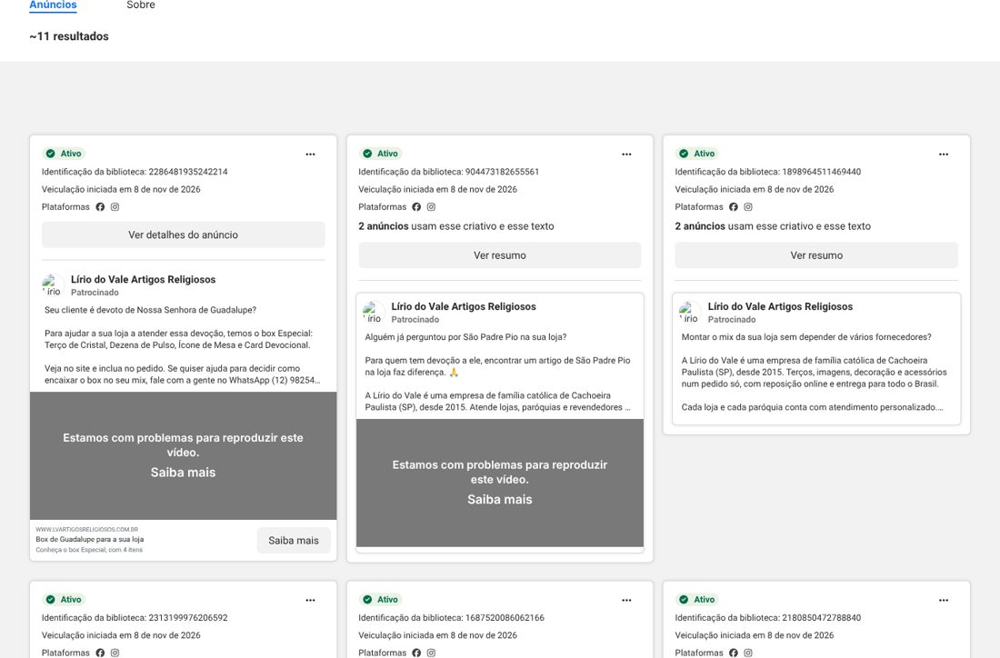

# 1. O que dá e o que não dá para ver

A Meta (dona do Facebook e do Instagram) tem a **Biblioteca de Anúncios**, pública, que mostra os **anúncios ativos** de qualquer página, com texto, data de início, plataformas e, às vezes, um aviso de **baixo volume de impressões**.

| Consigo ver | **Não** consigo ver (só com acesso ao Gerenciador de Anúncios) |
|---|---|
| Os anúncios **ativos hoje** e seus textos | Gasto, alcance, cliques, mensagens no WhatsApp, vendas |
| Data de início e plataformas (Facebook/Instagram) | Público (idade, região, interesses) |
| Se o anúncio teve **menos de 100 impressões** | Qual anúncio está ganhando |
| | Anúncios **antigos**: no Brasil, a biblioteca só mostra os ativos |

> 📌 **Página analisada:** "Lírio do Vale Artigos Religiosos", que anuncia no **Facebook e no Instagram**. Dados coletados em 12/11/2026.

# 2. Resumo executivo

- **11 anúncios ativos**, **todos iniciados em 08/11/2026**, ou seja, **4 dias antes desta análise**. É uma campanha nova.
- **A mensagem é a melhor que encontrei em todos os canais da Lírio.** Fala com o **lojista**, faz pergunta de dor ("O cliente pede Nossa Senhora de Guadalupe e a prateleira está vazia?"), apresenta a empresa ("família católica de Cachoeira Paulista desde 2015"), diz **pedido mínimo de R$ 500**, **cadastro na primeira compra** e chama para o **WhatsApp**.
- **Os pontos de atenção são estruturais:**
  - **4 dos 11 anúncios** estão com aviso de **"baixo volume de impressões" (menos de 100)**;
  - há **anúncios duplicados** (mesmo texto e criativo em 2 anúncios);
  - os temas de **Natal começaram tarde para o atacado**.

  Isso sugere **verba pulverizada** em muitos anúncios ao mesmo tempo.

**Nota da mensagem: 8,5 de 10. Nota da estrutura (pelo que é público): 5 de 10.**

# 3. Os anúncios

| # | Tema | Gancho (primeira frase) | Destino / Chamada | Observação |
|---|---|---|---|---|
| 1 | Box Guadalupe | "Seu cliente é devoto de Nossa Senhora de Guadalupe?" | Site · "Saiba mais" · cita WhatsApp | ✅ Bom. ⚠️ A composição do box difere do site |
| 2–3 | São Padre Pio | "Alguém já perguntou por São Padre Pio na sua loja?" | Site | ✅ Gancho excelente. Duplicado (2 anúncios) |
| 4–5 | Mix / fornecedor único | "Montar o mix da sua loja sem depender de vários fornecedores?" | Site | ✅ **Melhor argumento B2B.** Duplicado |
| 6–7 | Guadalupe em resina (4 tamanhos) | "O cliente pede Nossa Senhora de Guadalupe e a prateleira está vazia?" | Site · "Ver detalhes" | ✅ Bom: tamanhos concretos. Dois anúncios iguais |
| 8 | Natal: prateleira | "Como está a prateleira da sua loja para o fim do ano?" | Site | 🟡 Bom texto, timing tardio |
| 9 | Natal: estoque | "O Natal está chegando. Como está o estoque da sua loja?" | Site + WhatsApp | 🟡 **Baixo volume (<100 impressões)** |
| 10 | Natal: prateleira (repetido) | igual ao 8 | Site | 🟡 **Baixo volume (<100)** |
| 11 | Presépios (carrossel) | "O Natal está chegando..." | Site · cartões "Presépios para o Natal da sua loja" | 🟡 **Baixo volume (<100)**. O botão aparece em inglês ("**Learn More**") |

# 4. Diagnóstico

## O que está muito bom ✅
1. **Fala com o comprador certo.** Todos os textos tratam o leitor como **dono de loja/paróquia**: "sua loja", "seu cliente", "prateleira", "mix".
2. **Ganchos em forma de pergunta de dor**, uma técnica clássica de anúncio que prende a atenção.
3. **História e confiança:** "empresa de família católica de Cachoeira Paulista (SP), desde 2015". Isso diferencia a Lírio de importadoras e marketplaces.
4. **Regras claras no anúncio:** pedido mínimo de R$ 500 e cadastro. Isso **filtra o consumidor final antes do clique**, economizando dinheiro.
5. **WhatsApp com número no texto**, para quem prefere conversar.
6. **Temas certos de devoção:** Guadalupe (12/12), Padre Pio, Natal e presépio.

## O que precisa de ajuste 🟡🔴
1. 🔴 **Verba pulverizada.** São 11 anúncios ao mesmo tempo, 4 com menos de 100 impressões e vários duplicados. Com orçamento pequeno, o algoritmo da Meta **não consegue aprender** (ele precisa de cerca de **50 resultados por semana por conjunto de anúncios** para otimizar). **Recomendação:** 1 ou 2 campanhas, com 3 a 5 anúncios no máximo cada.
2. 🔴 **Pixel do Meta não confirmado no site.** Sem ele, a Meta não sabe quem se cadastrou ou comprou e otimiza no escuro, geralmente por "cliques baratos". **Confirmar com urgência.**
3. 🟡 **Natal começou em 08/11.** Para atacado, o ideal é **agosto a outubro**. Em novembro, o foco deveria ser **reposição rápida** ("ainda dá tempo: entregamos em X dias") e **Guadalupe/Advento**.
4. 🟡 **Composição do Box Guadalupe diferente do site.** O anúncio fala em "Dezena de Pulso, **Ícone de Mesa**" e o site em "**pulseira**, **medalha**". O lojista percebe e desconfia.
5. 🟡 **Botão "Learn More" em inglês** no carrossel de presépios. O idioma do anúncio precisa estar em português.
6. 🟡 **Texto longo para o Instagram.** Os anúncios têm de 5 a 6 parágrafos. No Instagram, só as **2 primeiras linhas** aparecem antes do "mais". O gancho está bom, mas o pedido mínimo e o WhatsApp ficam escondidos.
7. 🟡 **Destino genérico:** os anúncios levam para a home ou para busca. Uma **página "Seja revendedor"** e páginas de coleção (ex.: "Natal para lojistas") convertem melhor.
8. ⚪ **Formato:** não consegui ver as imagens e vídeos por bloqueio do meu ambiente. Na próxima etapa, preciso avaliar se a arte está na identidade (marrom/dourado) e se mostra a **loja abastecida**, não só o produto isolado.

## Objetivo da campanha: a pergunta mais importante
Para o atacado, existem dois objetivos que funcionam:
- **"Mensagens" (WhatsApp):** o anúncio abre uma conversa direta com o vendedor. É ótimo para quem fecha venda por WhatsApp e mede quantas conversas cada anúncio gera.
- **"Cadastros" (conversão no site):** exige o **Pixel** funcionando e o evento "cadastro concluído".

Se a campanha estiver em **"Tráfego" (cliques)**, ela traz visitas baratas e de baixa qualidade. **Isso precisa ser verificado na conta.**

# 5. Recomendações

**Estrutura sugerida (com orçamento pequeno ou médio)**

| Campanha | Objetivo | Público | Anúncios |
|---|---|---|---|
| **Lojistas novos** | Mensagens no WhatsApp | Interesses: comércio varejista, lojas de artigos religiosos, empreendedorismo + catolicismo; idade 25–60 | 3: "Mix num pedido só", "Padre Pio na sua loja", "Kit inicial com margem sugerida" |
| **Remarketing** | Cadastros / mensagens | Quem visitou o site ou interagiu com o Instagram nos últimos 30 dias | 2: depoimento de lojista + lançamento do mês |
| **Clientes atuais** (lista do ERP) | Vendas / mensagens | Lista de clientes (públicos personalizados) | 1–2: reposição e lançamentos |

**Criativos que costumam funcionar no atacado**
1. **Vídeo de 15–30 s mostrando a loja de um cliente abastecida** com produtos Lírio, com a frase "Esse é o resultado de um pedido de R$ 600".
2. **"Abrindo a caixa" do pedido de atacado**, mostrando volume, embalagem e cuidado.
3. **Carrossel "Kit Natal para loja pequena"**, com quantidade, preço total e margem sugerida.
4. **Depoimento em vídeo de lojista** ("compro há 3 anos, gira rápido").
5. **Bastidores em Cachoeira Paulista**, para reforçar a empresa familiar católica.

**Calendário de anúncios para o atacado**
- **Ago–out:** Natal, presépios, Advento e Black Friday do lojista.
- **Nov–dez:** reposição rápida, Guadalupe, planejamento da Quaresma.
- **Jan–fev:** Quaresma, Páscoa, Primeira Comunhão e Crisma (paróquias).
- **Mar–abr:** Dia das Mães, mês de Maria.
- **Mai–jun:** festas juninas, Santo Antônio, Corpus Christi.
- **Jul–ago:** Quaresma de São Miguel, Aparecida e Finados.

# 6. Como liberar o acesso para analisar os resultados

O dono do **Gerenciador de Negócios da Meta** (business.facebook.com) faz o seguinte:
1. **Configurações do negócio → Usuários → Pessoas → Adicionar** a pessoa com acesso à **Conta de anúncios** como **"Analista"** (só leitura).

Outra opção: no **Gerenciador de Anúncios**, escolher **últimos 90 dias**, abrir **Relatórios → Exportar dados da tabela (CSV)** por campanha, conjunto e anúncio, e colocar o arquivo em `dados/meta/`.

Com isso entrego: **custo por conversa no WhatsApp, custo por cadastro, qual anúncio pausar e onde aumentar a verba**.
